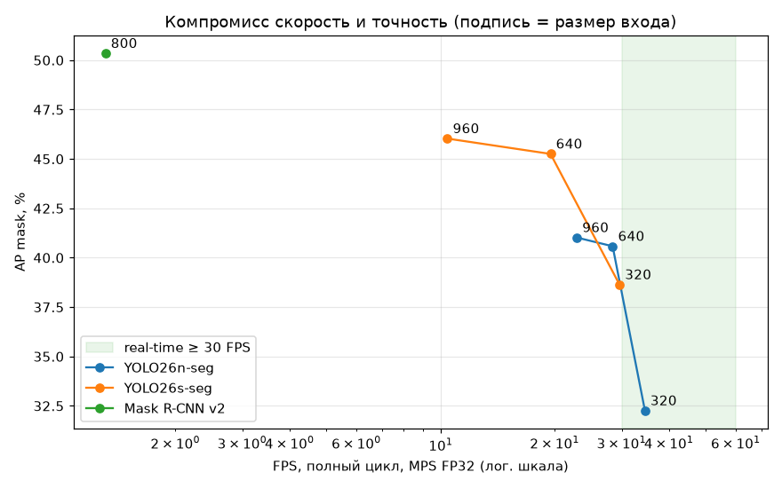

<div align="center">

# Instance Segmentation Benchmark

**Mask R-CNN v2 vs YOLO26-seg on COCO val2017: mask/box AP with pycocotools, FPS on GPU (Apple MPS) and CPU, and a speed vs accuracy map across input sizes.**


English · [Русский](README.ru.md)

</div>

---

## The question

Which instance segmentation model should you pick for a given job: a two-stage **Mask R-CNN** (torchvision, ResNet-50-FPN v2) or a one-stage **YOLO26-seg** (nano and small)? Every model is pretrained, and nothing is fine-tuned, so the comparison is purely about accuracy, speed and failure modes on the same images.

<p align="center"></p>

## Results

| Model | AP mask | AP box | AP<sub>S</sub> mask | Params | GFLOPs | FPS GPU (MPS, full pipeline) | FPS CPU |
|---|---:|---:|---:|---:|---:|---:|---:|
| Mask R-CNN v2 (800) | **50.3** | **57.5** | **34.7** | 46.4 M | 667 | 1.3 | 0.4 |
| YOLO26s-seg (640) | 45.3 | 54.0 | 25.9 | 11.5 M | 37.3 | 19.5 | 10.4 |
| YOLO26n-seg (640) | 40.6 | 48.3 | 21.4 | 3.1 M | 10.4 | **28.4** | **19.4** |

Input-size sweep (YOLO at 320 / 640 / 960):

| Model | 320 | 640 | 960 |
|---|---|---|---|
| YOLO26n-seg: AP mask · FPS | 32.3 · **34.6** | 40.6 · 28.4 | 41.0 · 22.9 |
| YOLO26s-seg: AP mask · FPS | 38.6 · 29.6 | 45.3 · 19.5 | **46.0** · 10.4 |

### Findings

- **The ranking matches the official docs**: Mask R-CNN > YOLO26s > YOLO26n. The GFLOPs check also matches: 667 measured = 2 × 333.6 GMAC from torchvision, because `FlopCounterMode` counts FLOPs and torchvision reports MACs.
- **Mask AP is 7–9 points below box AP for every model.** Pixel-level IoU punishes boundary errors, and masks are predicted at low resolution (28×28 for Mask R-CNN, 160×160 prototypes for YOLO).
- **Small objects are where the two-stage model wins**: AP<sub>S</sub> 34.7 vs 25.9. Input size explains most of the gap: YOLO26s goes from 13.0 at 320 to 31.7 at 960.
- **At equal speed, a small model with a large input beats a large model with a small input**: n-seg at 640 (28.4 FPS, 40.6 AP) vs s-seg at 320 (29.6 FPS, 38.6 AP).
- **Only YOLO at 320 is real-time (≥ 30 FPS) on this laptop.** Mask R-CNN is the accurate outlier, 15–20× slower, since RoIAlign and mask pasting run poorly on MPS.
- FP16 on MPS gave little or nothing, and the "network only" FP16 timing was slower than FP32. I report it but don't trust it.

### Which one to use

| Scenario | Pick |
|---|---|
| Real-time video (drone, traffic camera) | YOLO26-seg: s on a GPU, n or 320 input on weak hardware |
| Offline labelling with precise contours, many small objects | Mask R-CNN, or a large YOLO-seg at 960+ |
| CPU-only device | YOLO26n-seg (19 FPS on an M4 CPU), ideally exported to ONNX / CoreML |

## What's inside

```text
src/
  data.py        reproducible 500-image COCO val2017 subset (seed 42), image download
  models.py      torchvision Mask R-CNN v2, Ultralytics YOLO26-seg wrappers
  predict.py     unified predictions → COCO results JSON (RLE masks)
  evaluate.py    pycocotools AP / AP_S for masks and boxes
  speed.py       FPS: full pipeline vs network only, FP32 / FP16, GPU / CPU, with warm-up
  experiments.py cached runs: every heavy result is written once to results/
  run_all.py     one command for the whole benchmark
notebooks/mask_rcnn_vs_yolo_seg.ipynb   EDA, results, plots, conclusions (outputs saved)
REPORT.ru.md                             the full write-up (in Russian)
```

## Run it

```bash
python -m venv .venv && source .venv/bin/activate
pip install -r requirements.txt
python -m src.run_all          # downloads the subset, predicts, evaluates, times (~15 min on an M4)
jupyter nbconvert --to notebook --execute --inplace notebooks/mask_rcnn_vs_yolo_seg.ipynb
```

To redo the timing, delete `results/tables/speed_raw.csv`. To redo AP, delete `results/tables/ap_raw.csv` and `results/preds/`.

## Limitations

- To keep the run short, AP is computed on 150 images (1,054 objects) of the 500-image subset, and FPS on 60 (GPU) / 20 (CPU) images. Absolute AP is therefore a few points above the docs, though the ranking is stable. Set `N_AP = 500` and `N_SPEED = 200` for the full protocol (≈1 h).
- There is no CUDA here. "GPU" means Apple MPS, so absolute FPS is not comparable to CUDA / TensorRT numbers.

## License

[MIT](LICENSE)
