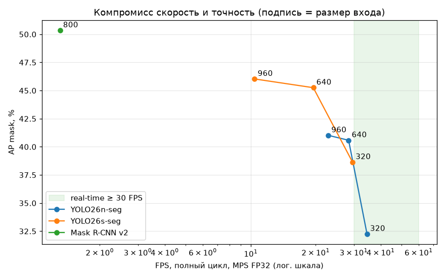

<div align="center">

# Instance Segmentation Benchmark

**Mask R-CNN v2 против YOLO26-seg на COCO val2017: AP масок и рамок через pycocotools, FPS на GPU (Apple MPS) и CPU, карта «скорость против точности» для разных размеров входа.**


[English](README.md) · Русский

</div>

---

## Вопрос

Какую модель сегментации экземпляров брать под конкретную задачу: двухстадийную **Mask R-CNN** (torchvision, ResNet-50-FPN v2) или одностадийную **YOLO26-seg** (nano и small)? Все модели готовые, без дообучения, поэтому сравниваются только точность, скорость и типичные ошибки на одних и тех же фото.

<p align="center"></p>

## Результаты

| Модель | AP mask | AP box | AP<sub>S</sub> mask | Параметры | GFLOPs | FPS GPU (MPS, полный цикл) | FPS CPU |
|---|---:|---:|---:|---:|---:|---:|---:|
| Mask R-CNN v2 (800) | **50.3** | **57.5** | **34.7** | 46.4 M | 667 | 1.3 | 0.4 |
| YOLO26s-seg (640) | 45.3 | 54.0 | 25.9 | 11.5 M | 37.3 | 19.5 | 10.4 |
| YOLO26n-seg (640) | 40.6 | 48.3 | 21.4 | 3.1 M | 10.4 | **28.4** | **19.4** |

Разные размеры входа (YOLO на 320 / 640 / 960):

| Модель | 320 | 640 | 960 |
|---|---|---|---|
| YOLO26n-seg: AP mask · FPS | 32.3 · **34.6** | 40.6 · 28.4 | 41.0 · 22.9 |
| YOLO26s-seg: AP mask · FPS | 38.6 · 29.6 | 45.3 · 19.5 | **46.0** · 10.4 |

### Выводы

- **Порядок моделей совпадает с документацией**: Mask R-CNN > YOLO26s > YOLO26n. Проверка GFLOPs тоже сходится: замер 667 = 2 × 333.6 GMAC из torchvision, потому что `FlopCounterMode` считает FLOPs, а torchvision указывает MAC.
- **AP масок на 7–9 пунктов ниже AP рамок у всех моделей.** Пиксельный IoU сильнее наказывает ошибки на границе, а маски предсказываются в низком разрешении (28×28 у Mask R-CNN, прототипы 160×160 у YOLO).
- **На мелких объектах выигрывает двухстадийная модель**: AP<sub>S</sub> 34.7 против 25.9. Разрыв во многом объясняет размер входа: у YOLO26s AP<sub>S</sub> растёт с 13.0 на 320 до 31.7 на 960.
- **При равной скорости маленькая модель с большим входом лучше большой с маленьким**: n-seg на 640 (28.4 FPS, AP 40.6) против s-seg на 320 (29.6 FPS, AP 38.6).
- **Real-time (≥ 30 FPS) на этом ноутбуке дают только YOLO на 320.** Mask R-CNN стоит отдельной точкой: самая точная, но в 15–20 раз медленнее, потому что RoIAlign и вставка масок плохо работают на MPS.
- FP16 на MPS почти ничего не дал, а замер «только сеть» в FP16 оказался медленнее FP32. Я его привожу, но не доверяю ему.

### Что выбрать

| Сценарий | Выбор |
|---|---|
| Видео в реальном времени (дрон, камера на перекрёстке) | YOLO26-seg: s на GPU, n или вход 320 на слабом железе |
| Офлайн-разметка с точными контурами, много мелких объектов | Mask R-CNN или крупная YOLO-seg на 960+ |
| Устройство без GPU | YOLO26n-seg (19 FPS на CPU M4), лучше после экспорта в ONNX / CoreML |

## Что внутри

```text
src/
  data.py        воспроизводимая подвыборка COCO val2017 из 500 фото (seed 42), загрузка картинок
  models.py      обёртки torchvision Mask R-CNN v2 и Ultralytics YOLO26-seg
  predict.py     единый формат предсказаний → COCO results JSON (RLE-маски)
  evaluate.py    AP / AP_S масок и рамок через pycocotools
  speed.py       FPS: полный цикл и только сеть, FP32 / FP16, GPU / CPU, с прогревом
  experiments.py прогоны с кэшем: каждый тяжёлый результат пишется в results/ один раз
  run_all.py     весь бенчмарк одной командой
notebooks/mask_rcnn_vs_yolo_seg.ipynb   EDA, результаты, графики, выводы (выводы сохранены)
REPORT.ru.md                             подробный отчёт
```

## Запуск

```bash
python -m venv .venv && source .venv/bin/activate
pip install -r requirements.txt
python -m src.run_all          # скачивает подвыборку, предсказывает, считает AP и FPS (~15 мин на M4)
jupyter nbconvert --to notebook --execute --inplace notebooks/mask_rcnn_vs_yolo_seg.ipynb
```

Чтобы пересчитать FPS, удали `results/tables/speed_raw.csv`. Чтобы пересчитать AP, удали `results/tables/ap_raw.csv` и `results/preds/`.

## Ограничения

- Ради короткого прогона AP посчитан на 150 фото (1 054 объекта) из подвыборки в 500, FPS — на 60 (GPU) и 20 (CPU) фото. Поэтому абсолютный AP на несколько пунктов выше документации, но порядок моделей устойчив. Для полного протокола поставь `N_AP = 500` и `N_SPEED = 200` (≈1 ч).
- CUDA здесь нет. «GPU» означает Apple MPS, так что абсолютные FPS нельзя сравнивать с цифрами для CUDA / TensorRT.

## Лицензия

[MIT](LICENSE)
